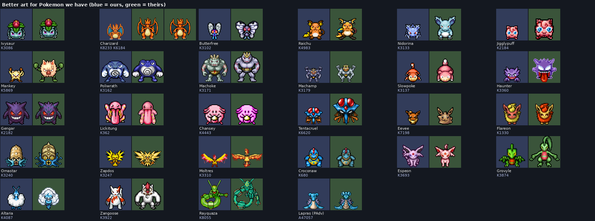

# Art audit: PAdventures and the 6500 pack

What PAdventures' creature sheets and the 6500 sprite pack have that we don't: trainer outfits,
outfit add-ons, Pokémon costumes, and better art for Pokémon we already have. Recolours don't
count. Nothing here is imported yet; this is the list to pick from.

We have permission to use PAdventures' art (see [future-generations.md](../future-generations.md)).

## Summary

| What | Found | Where to look |
| --- | --- | --- |
| Trainer outfits we don't have | 1,154 unique shapes: 760 from PAdventures, 394 from the pack | [trainer pages](#trainer-outfits), `trainer_outfits.csv` |
| Trainer outfits with add-ons | 145, all PAdventures (72 also have a mount) | `addons_1.png`, `addons_2.png` |
| Pokémon costumes | 113 from the pack and 27 more from PAdventures | `costumes_pack.png`, `costumes_padv.png`, `costumes.csv` |
| Better art for Pokémon we have | 23 species from the pack and 1 from PAdventures | `better.png`, `better_art.csv` |

**Short version:**

- **PAdventures** is the place for trainer outfits. Its outfits are colourable greyscale like
  ours, and many come with two add-ons. They are mostly fantasy: armour, robes, mages,
  assassins, archers, pirates and the like.
- **PAdventures' Gen 1 to 3 Pokémon are mostly our own art.** About 700 of its sheets match
  ours tile for tile, and most of the rest are tiny edits. It has very few real redraws.
- **The pack** is the place for better Pokémon art and costumes. Its folder 09 ("other art for
  Pokémon we have") has the bigger, more detailed redraws.
- **The pack's trainer outfits are mostly pre-coloured** (290 of 394), so they can't take
  player colours. Many are characters from other franchises and shouldn't be used.

## How it was checked

- **Matching:** every 32×32 tile was compared with every tile in our `data.spr`.
  - A sheet that is at least half our tiles counts as ours and is left out.
  - A sheet that matches a pack sprite counts as that pack sprite, so the two sources aren't
    listed twice.
- **Recolours:** sprites with the same outline (alpha shape) count as one. Only the first of
  each shape is listed, and the "copies" column in `trainer_outfits.csv` says how many recolours
  were folded into it.
- **PAdventures has no names,** so each of its Pokémon sprites was matched to our nearest
  Pokémon by colour and shape. The closest 700 were then checked by eye. Past that point the
  matches are other Pokémon and monsters, mostly Gen 4 and up.
- **Names for the pack** come from the earlier review in [sprite-pack-review](../sprite-pack-review/README.md).
- **Ids:** `A` + number is a PAdventures creature id
  (`sprites/creature/<id>.png` in [padventures-sprites](https://github.com/DistTopic/padventures-sprites)).
  `K` + number is the pack's `outfit_<n>_.png`. `#` + number is our look type.
- **Sheet colours:** blue cells are ours and green cells are theirs.

## Better art for Pokémon we have

Picked because they're bigger, have more shading, or read better than ours at game size:

- **Starters:** Ivysaur and Charizard (two versions).
- **Kanto:** Butterfree, Raichu, Nidorina, Jigglypuff, Mankey, Poliwrath, Machoke, Machamp,
  Slowpoke, Haunter, Chansey, Tentacruel, Eevee, Flareon, Omastar, Zapdos and Moltres.
- **Hoenn:** Grovyle, Altaria, Zangoose and Rayquaza.
- **From PAdventures:** Lapras, with more shading.

**Not picked:** many folder 09 sprites are just *different*: smaller (Typhlosion, Ursaring,
Kingler, Pelipper), sitting poses, or about the same as ours (Gengar, Lickitung, Croconaw,
Espeon). They're all in `pages/pack_other_art_*.png`, ours beside theirs, if you want to look
again. Only the south-facing frame is shown, so check the other directions and the walk frames
before swapping anything.

## Pokémon costumes

Pokémon wearing something. These are mostly our sprites with a hat or outfit drawn on, so the
style matches.

**6500 pack (113):** a full Christmas set, including:

- Santa Snorlax, Slaking, Stantler, Jynx, Psyduck, Bellsprout and Pikachu;
- Christmas-tree Trevenant;
- Halloween Charizard, Venusaur, Snorlax and Torterra;
- balloon Pikachu and Raichu;
- nurse Chansey, angel Clefairy, Squirtle Squad sunglasses, winged Rapidash, vampire Gengar,
  a pirate Crawdaunt, knights, wizards and dinosaur suits.

**PAdventures (27 not in the pack):**

- Santa hats on Hitmontop, Hitmonchan, Pidgey, Cubone, Diglett and Raichu;
- crowns on Espeon and Umbreon;
- wizard and witch hats on Ampharos, Aggron and Diglett;
- a pumpkin Snorlax, a Christmas-tree Sudowoodo, Raichu with mouse ears, and Lapras with a rider.

**Don't use:** Stitch, Batman and Captain America (marked "other franchise" in
`costumes.csv`).

The Christmas and Halloween ones fit the [holiday calendar](../upcoming-features.md) as event
looks or store add-ons.

## Trainer outfits

### With add-ons (PAdventures)

Each row shows the base outfit, then add-on 1, then add-on 2 drawn on top. They follow the same
layout as our outfits (two add-on rows), and 72 also have a mount row.

- **What they are:** mostly armour, hooded robes, mages with staffs, archers, spearmen, a
  gold-armour set, and a few with wings or capes.
- **Colour:** PAdventures only exports the base layer, so they show as grey here. In game they
  take player colours like ours.
- **Style:** they're darker and more Tibia than our Pokémon-trainer outfits, so they suit an
  event, a PvP set or a store theme better than the default list.

### Everything else

`pages/trainers_01.png` to `trainers_08.png` show all 1,154: PAdventures first, then the pack.
`+` means the outfit has add-ons.

**PAdventures (615 without add-ons):**

- fantasy classes;
- nobles, pirates, monks, ninjas;
- swimsuits and casual clothes;
- a few Pokémon-trainer looks.

**Pack (394):**

- 104 are colourable;
- the rest are pre-coloured:
  - Pokémon onesies (Eevee and every Eeveelution, Mew, Mewtwo, the legendary birds, Meganium);
  - fishing, diving and swimming poses;
  - chairs and wheelchairs;
  - anime gym leaders.

**Don't use (other franchises):** Saint Seiya armour, Dragon Ball, Naruto, Sonic, Mortal Kombat,
Spider-Man and The Simpsons. They're on the pack pages at the end of `pages/trainers_*.png`.

**Best fits for us:**

- The pack's Pokémon onesies are pre-coloured but very on-theme. They could be fixed-colour
  store outfits.
- Its fishing and diving poses would suit fishing and surfing.
- PAdventures' casual and swimsuit outfits are colourable and fit the default list.

## Files

| File | What |
| --- | --- |
| `better.png`, `better_art.csv` | Picked redraws, with our look type |
| `costumes_pack.png`, `costumes_padv.png`, `costumes.csv` | All costumes, with our base look type |
| `addons_1.png`, `addons_2.png` | PAdventures outfits with add-ons |
| `trainer_outfits.csv` | All 1,154 outfits: source, id, colourable, add-on count, mount, recolour count |
| `pages/trainers_*.png` | Every trainer outfit |
| `pages/pack_other_art_*.png` | All of pack folder 09 next to ours (for reviewing better art) |
| `pages/padventures_nearest_*.png` | PAdventures sprites closest to our Pokémon that aren't our art |

The scripts that made these are in [scripts/art/audit](../../scripts/art/audit/README.md).
