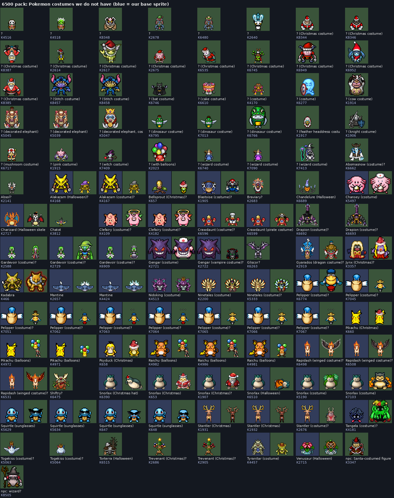
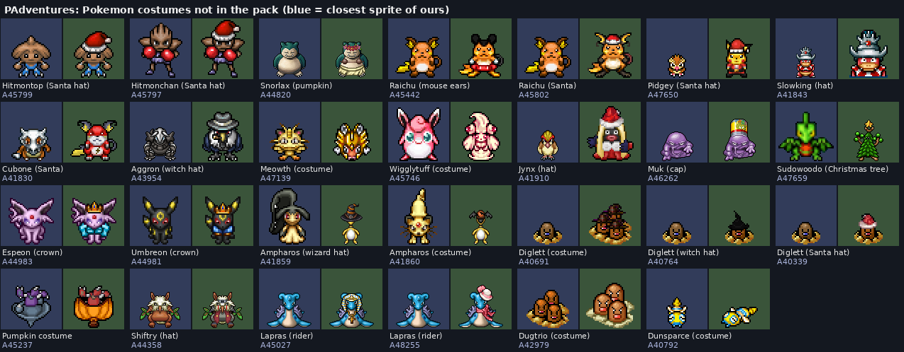
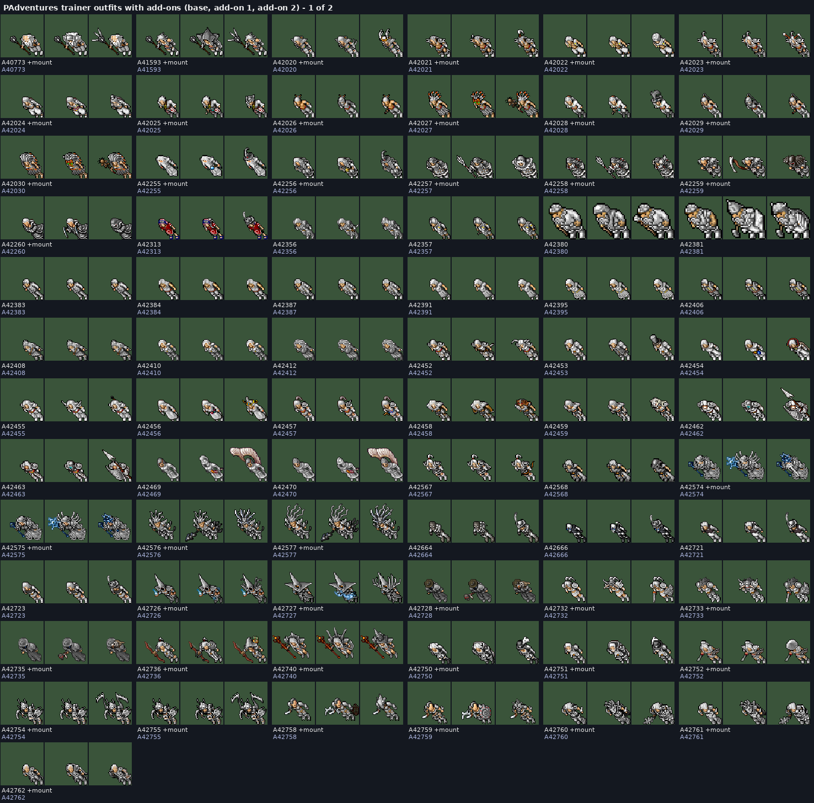
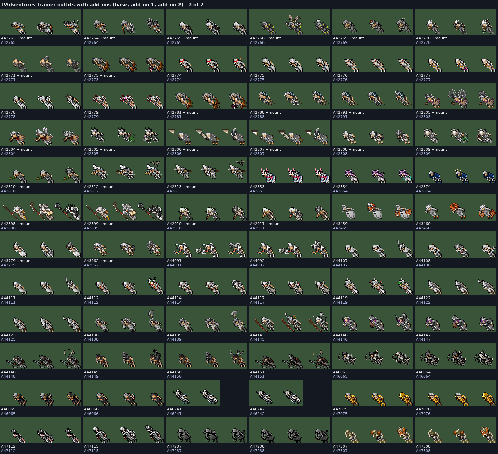

# Art audit: PAdventures and the 6500 pack

What PAdventures' creature sheets and the 6500 sprite pack have that we don't: trainer outfits,
outfit add-ons, Pokémon costumes, and better art for Pokémon we already have. Recolours don't
count. Nothing here is imported yet; this is the list to pick from.

We have permission to use PAdventures' art (see [future-generations.md](../future-generations.md)).

## Summary

| What | Found | Where to look |
| --- | --- | --- |
| Trainer outfits we don't have | 1,154 unique shapes: 760 from PAdventures, 394 from the pack | [trainer pages](#trainer-outfits), `trainer_outfits.csv` |
| Trainer outfits with add-ons | 145, all PAdventures (72 also have a mount) | `addons_1.png`, `addons_2.png` |
| Pokémon costumes | 113 from the pack and 27 more from PAdventures | `costumes_pack.png`, `costumes_padv.png`, `costumes.csv` |
| Possible better art for Pokémon we have | 492 candidates for 228 Pokémon, for picking by hand | `review/`, `better_art_picks.csv` |

**Short version:**

- **PAdventures' trainer outfits are mostly Tibia-style fantasy,** not Pokémon: armour, robes,
  mages, assassins and archers. That includes all 145 with add-ons. They're colourable like
  ours, but most don't fit the game.
- **PAdventures' Gen 1 to 3 Pokémon are mostly our own art.** About 700 of its sheets match
  ours tile for tile, and most of the rest are tiny edits. It has very few real redraws.
- **The pack** is the place for Pokémon redraws and costumes. Its folder 09 ("other art for
  Pokémon we have") has the redraws, for picking one by one.
- **The pack's trainer outfits are mostly pre-coloured** (290 of 394), so they can't take
  player colours. Many are characters from other franchises and shouldn't be used.

## How it was checked

- **Matching:** every 32×32 tile was compared with every tile in our `data.spr`.
  - A sheet that is at least half our tiles counts as ours and is left out.
  - A sheet that matches a pack sprite counts as that pack sprite, so the two sources aren't
    listed twice.
- **Recolours:** sprites with the same outline (alpha shape) count as one. Only the first of
  each shape is listed, and the "copies" column in `trainer_outfits.csv` says how many recolours
  were folded into it.
- **PAdventures has no names in the repo.** Only its sprites that share tiles with ours are
  named here.
- **Names for the pack** come from the earlier review in [sprite-pack-review](../sprite-pack-review/README.md).
- **Ids:** `A` + number is a PAdventures creature id
  (`sprites/creature/<id>.png` in [padventures-sprites](https://github.com/DistTopic/padventures-sprites)).
  `K` + number is the pack's `outfit_<n>_.png`. `#` + number is our look type.
- **Sheet colours:** blue cells are ours and green cells are theirs.

## Better art for Pokémon we have

Nothing is pre-picked: every swap is your call. `review/better_art_01.png` to `better_art_24.png`
give each Pokémon one row:

- our sprite first (blue, front and side view);
- then every candidate (green, numbered, with its code);
- all at the same scale, so size differences show.

There are 228 Pokémon with 492 candidates between them. Write the number you want in the
**Pick** column of `better_art_picks.csv`, or leave it blank to keep ours.

**Where the candidates come from:**

- **Pack folder 09.** Its names come from the earlier review, and some are wrong.
- **PAdventures sheets that share tiles with our sprite.** These are edits of ours, so the
  species is right.

PAdventures sprites that only *look like* ours were left out, because that matching was too
often wrong. Once the PAdventures Pokédex names are in (website look type = repo creature id −
40034, so Bulbasaur 25 = `40059.png`), its real redraws can be added as their own rows.

Check the walk frames in the source sheet before swapping. The page only shows the standing
frame.

## Pokémon costumes

Pokémon wearing something. These are mostly our sprites with a hat or outfit drawn on, so the
style matches.

**6500 pack (113):** a full Christmas set, including:

- Santa Snorlax, Slaking, Stantler, Jynx, Psyduck, Bellsprout and Pikachu;
- Christmas-tree Trevenant;
- Halloween Charizard, Venusaur, Snorlax and Torterra;
- balloon Pikachu and Raichu;
- nurse Chansey, angel Clefairy, Squirtle Squad sunglasses, winged Rapidash, vampire Gengar,
  a pirate Crawdaunt, knights, wizards and dinosaur suits.

**PAdventures (27 not in the pack):**

- Santa hats on Hitmontop, Hitmonchan, Pidgey, Cubone, Diglett and Raichu;
- crowns on Espeon and Umbreon;
- wizard and witch hats on Ampharos, Aggron and Diglett;
- a pumpkin Snorlax, a Christmas-tree Sudowoodo, Raichu with mouse ears, and Lapras with a rider.

**Don't use:** Stitch, Batman and Captain America (marked "other franchise" in
`costumes.csv`).

The Christmas and Halloween ones fit the [holiday calendar](../upcoming-features.md) as event
looks or store add-ons.

## Trainer outfits

### With add-ons (PAdventures)

Each row shows the base outfit, then add-on 1, then add-on 2 drawn on top. They follow the same
layout as our outfits (two add-on rows), and 72 also have a mount row.

- **What they are:** mostly armour, hooded robes, mages with staffs, archers, spearmen, a
  gold-armour set, and a few with wings or capes.
- **Colour:** PAdventures only exports the base layer, so they show as grey here. In game they
  take player colours like ours.
- **Style:** Tibia fantasy, not Pokémon. Most won't fit; they're listed so nothing is missed.

### Everything else

`pages/trainers_01.png` to `trainers_08.png` show all 1,154: PAdventures first, then the pack.
`+` means the outfit has add-ons.

**PAdventures (615 without add-ons):**

- fantasy classes;
- nobles, pirates, monks, ninjas;
- swimsuits and casual clothes;
- a few Pokémon-trainer looks.

**Pack (394):**

- 104 are colourable;
- the rest are pre-coloured:
  - Pokémon onesies (Eevee and every Eeveelution, Mew, Mewtwo, the legendary birds, Meganium);
  - fishing, diving and swimming poses;
  - chairs and wheelchairs;
  - anime gym leaders.

**Don't use (other franchises):** Saint Seiya armour, Dragon Ball, Naruto, Sonic, Mortal Kombat,
Spider-Man and The Simpsons. They're on the pack pages at the end of `pages/trainers_*.png`.

**Picking:** mark the ones you want in the Pick column of `trainer_outfits.csv`. Each page shows
the code under every outfit.

## Files

| File | What |
| --- | --- |
| `review/better_art_*.png`, `better_art_picks.csv` | Every candidate redraw next to ours, with a Pick column |
| `costumes_pack.png`, `costumes_padv.png`, `costumes.csv` | All costumes, with our base look type and a Pick column |
| `addons_1.png`, `addons_2.png` | PAdventures outfits with add-ons |
| `trainer_outfits.csv` | All 1,154 outfits: source, id, colourable, add-on count, mount, recolour count, Pick column |
| `pages/trainers_*.png` | Every trainer outfit |

The scripts that made these are in [scripts/art/audit](../../scripts/art/audit/README.md).
