# PokeZHero contact sheets

Rendered from the PokeZHero OTC 1.2 client. Ids match `../pokezhero-items.csv` and `../pokezhero-outfits.csv`. The non-Tibia floors, walls, machines and trees and every trainer and Pokemon look are imported in #386 (see `../pokezhero.md`).

## Trainer outfits

All 590 looks in the trainer group (2024-2844), facing south on the first walk frame, coloured head yellow, body red, legs blue, feet brown. A `*` after the id means the look also exists in PAdventures or the 6500 pack.

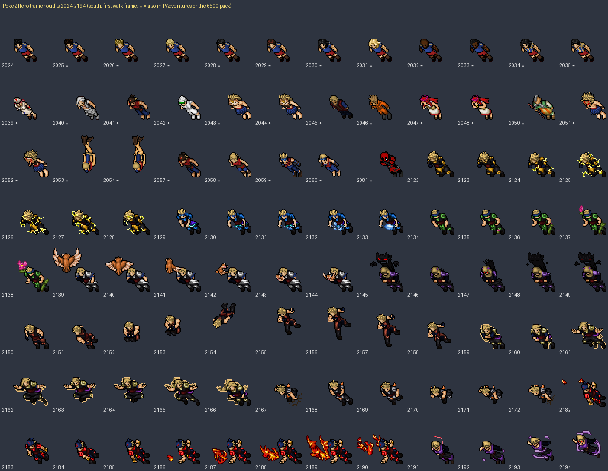
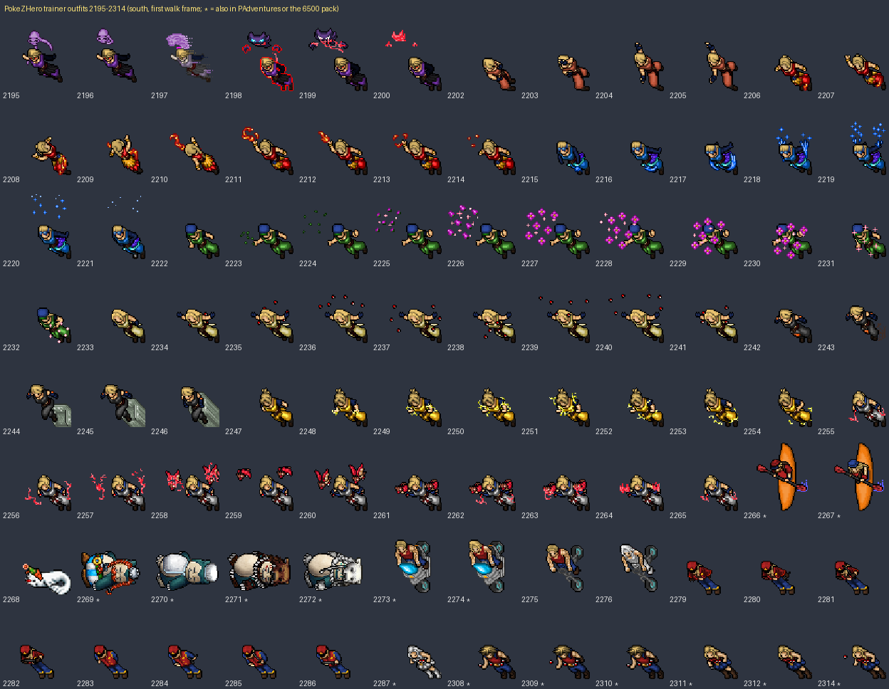
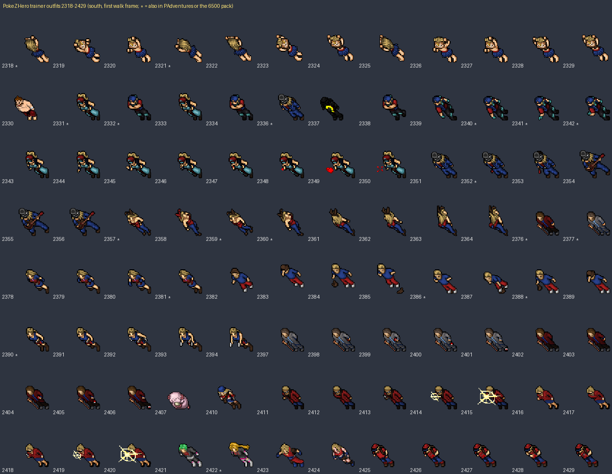
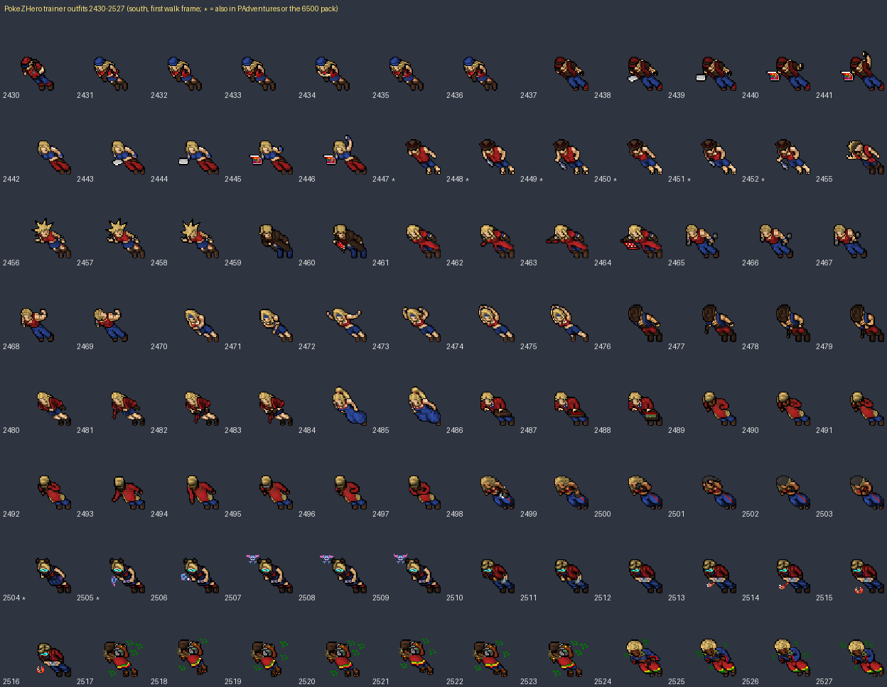
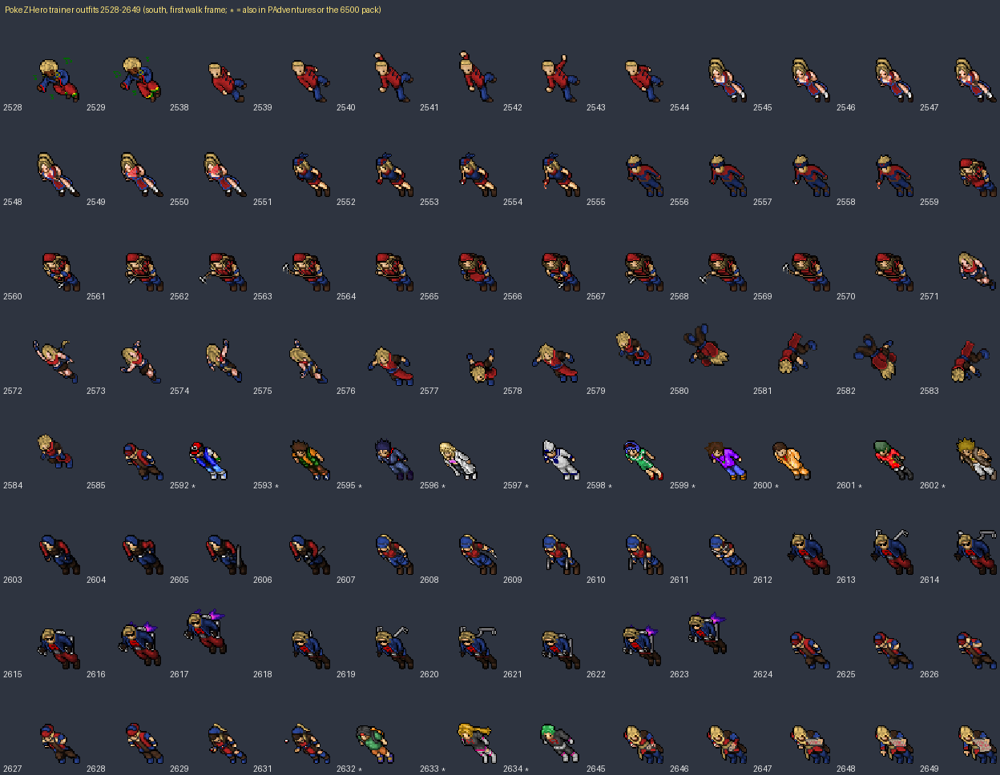
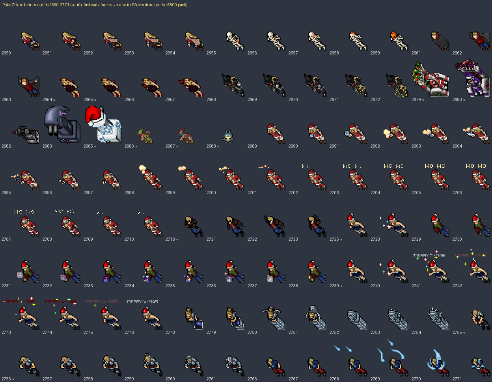
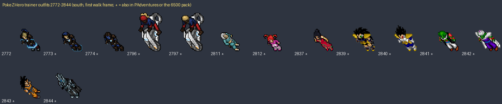

## Building pieces that are not Tibia

A `*` marks floors with a logo or brand on them (Poke Ball pieces, the green gym emblem, the "PokeDash" beige set). 29320 and 29324 are the plain beige tiles from that set.

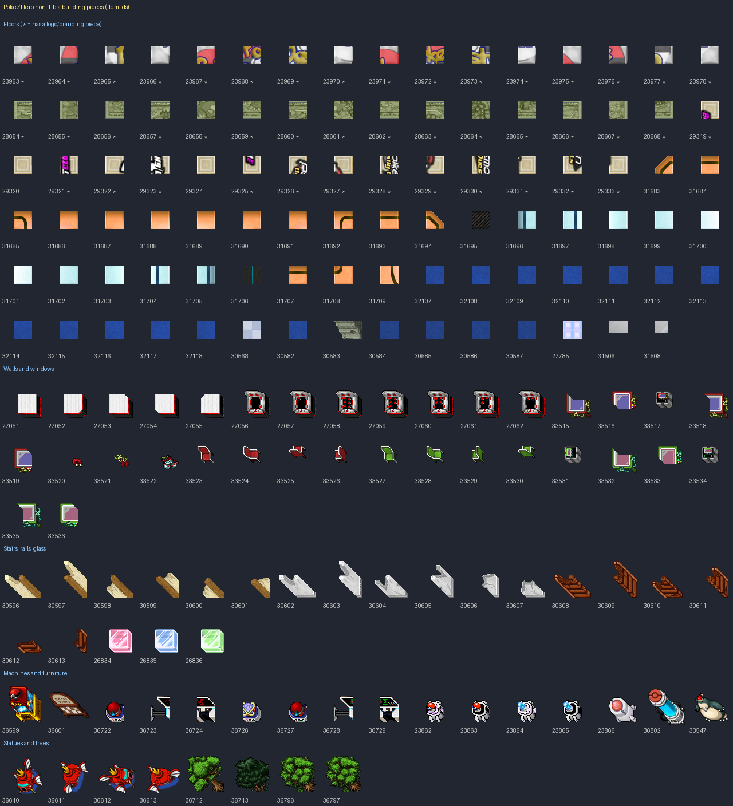

Checked against our sprites: everything on this sheet is new except these, which we already have:

- 29320 and 29324, the plain beige tiles (29320 matches one of ours pixel for pixel)
- 31695-31706, the light blue glass tiles and the two dark grid tiles in the orange range

### Orange floor set (31683-31709)

Cut corners 31683 and 31694, the border line 31684 / 31693 / 31707, and plain fill 31686-31691. 31708 and 31685 + 31709 turn the line down at the ends.

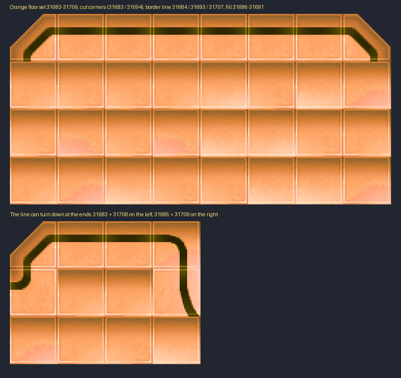

## Mock-ups

Pokemon Center lobby: beige floor 29320/29324, light blue 30568 in front of the counter, white wall blocks 27051 with framed windows 33515, healing machines 36722/36727, PCs 36723/36724 and 36728/36729, vending machine 36599, robots 23862-23866, capsule 36802, Daily Board 36601, Snorlax bed 33547.

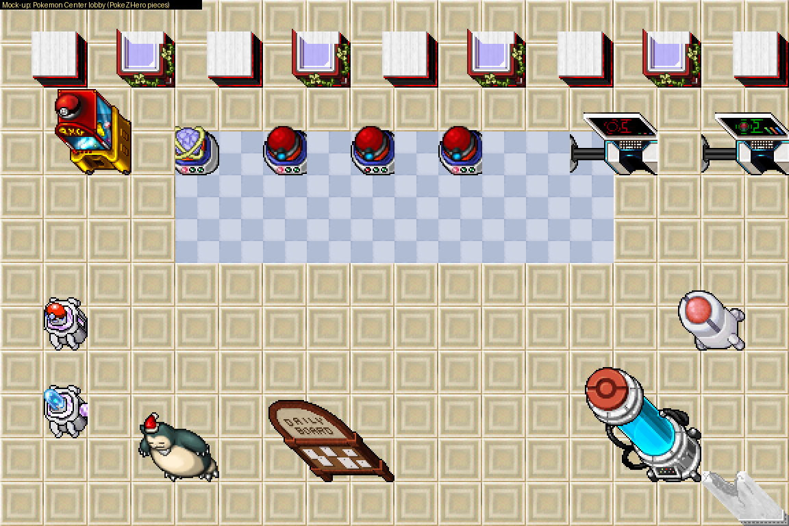

Town square on Tibia grass 4526: beige path, orange track 31686, blue pool 32107 with the Magikarp statue 36610, trees 36712/36713/36796/36797.

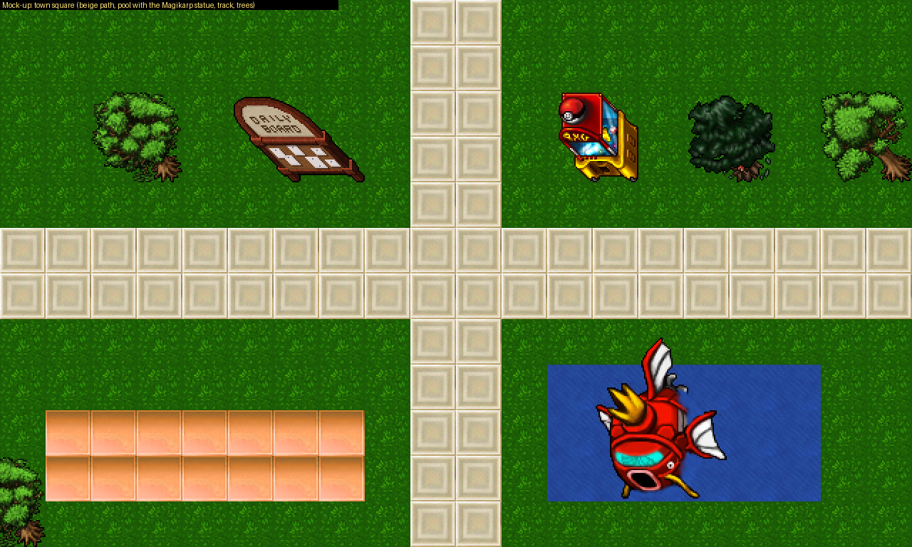

## White exterior walls (2222-2233)

We already have these (ours are 2222-2233 and the cream 24871-24877), so they are not imported: 2222 runs left-right, 2224 up-down, 2228 is the corner and 2226 the end post. 2230 / 2231 / 2233 are the same walls with grey window frames. 2223 / 2225 / 2229 are a cream version with a carved trim, and 5009 / 5010 a plain cream one.

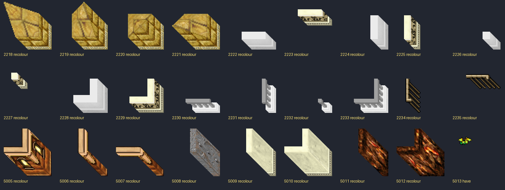

The mock-up uses our beige floor and grass with the PokeZHero healing machines, PC, vending machine and trees. The corner overlap at the top left is a limit of the mock-up drawing, not the art.

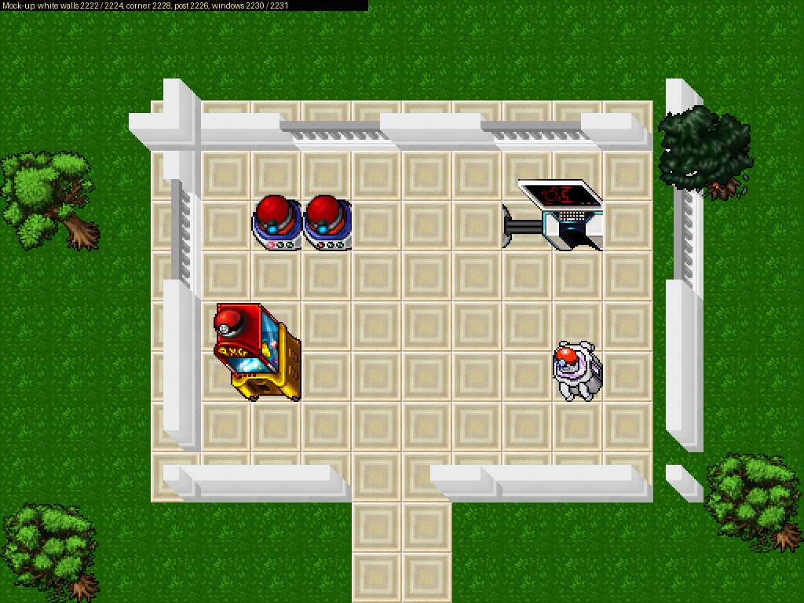
