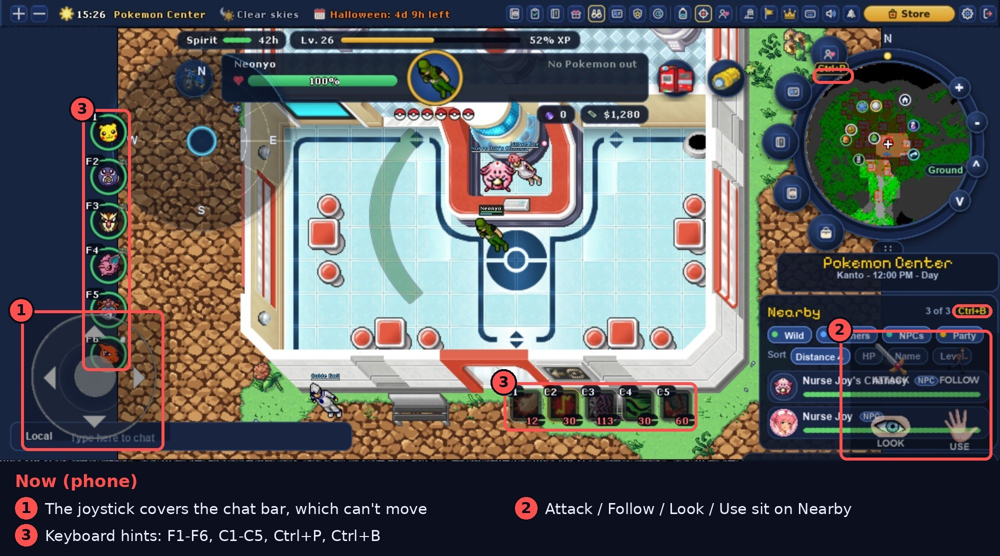
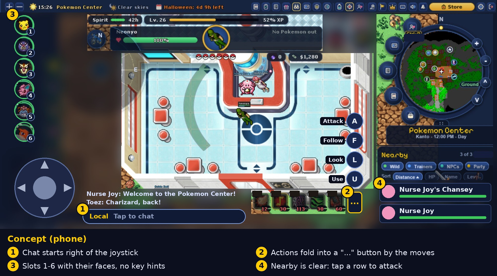

# Phone layout (Android) — concept

Concept only, nothing is built yet. Tablets already look right; this is about phones,
where the screen is short and every corner is used.

## Already fine

- **Radar** can be dragged anywhere.
- **Pokemon bar** can be dragged; top-left works well on phones.

## 1. Chat vs joystick

The joystick (stock Redemption `game_joystick`) sits in the bottom-left corner, right on top
of the folded Pokegear chat bar. The folded bar has no header, so it can't be dragged out
from under the joystick.

On phones the folded chat bar starts **right of the joystick** instead of at the screen edge.
It ends before the moves bar. The last couple of lines still float above it, and tapping
it opens the full chat card with the keyboard as it does today.

Alternatives if that is too narrow:

- Small chat bubble button above the joystick (with an unread dot). Tapping it opens the card.
- Make the folded bar draggable with a long press.

## 2. Action buttons (Attack / Follow / Look / Use)

They come from the stock mobile `game_shortcuts` module, pinned bottom-right, and cover the
Nearby card. Most of what they do is already reachable:

- Tap a Nearby row to attack it.
- Long-press anything on the map for its menu (Look, Use, Follow…).

Concept: hide them by default and put a **"…" button at the end of the moves bar**. Tapping
it slides the four buttons up in a column, each a one-shot mode like today (tap the button,
then tap the target). Tapping "…" again or using one of the buttons closes it.

## 3. Keyboard hints

Phones have no F-keys or Ctrl. On mobile hide F1–F6, C1–C5, Ctrl+P, Ctrl+B and similar,
and show slot numbers 1–6 on the Pokemon bar instead.

## 4. Nearby

With the buttons gone the rows are readable and tappable again. No other change.

## Open questions

- Keep the "…" drawer, or drop the actions entirely on phones?
- Chat beside the joystick, or a chat bubble button?
- Apply this to all mobile clients, or only phones (use the compact check) and leave tablets
  as they are?
