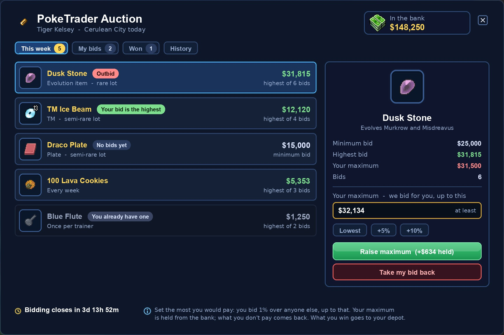
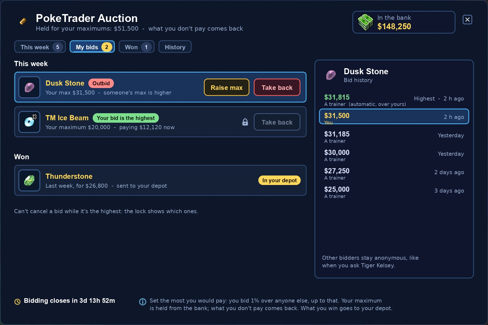
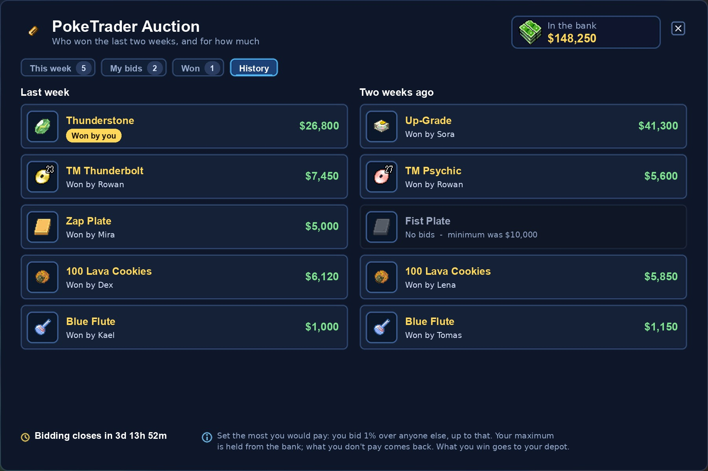
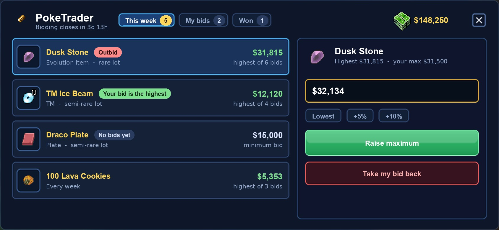

# PokeTrader auction window: concept

This is a concept only; nothing is built yet. Today the auction lives only in Tiger Kelsey's chat
(`npc/scripts/poketrader.lua`): you say "offers", the item's name, "bids", "cancel" and "time". The
window shows the same auction, so players can see the lots and bid without typing.

The art comes from the game's own UI: the Tasks window frame, the Fishing Guide's rows, tabs and
panels, and the login screen's fields and buttons. It matches the Event Shop and Bank windows. The
item icons are the real sprites. The lots, bids and money in the pictures are made up. To redraw the
pictures, run `scripts/art/poketrader_concept.py`.

## Opening it

- Talk to Tiger Kelsey and say "hi". The window opens, and the chat words still work.
- You can only bid at Tiger Kelsey. There is no PokeGear button, and the window closes when you
  walk away from him, like a shop.

## Maximum bids

You don't bid an amount. You set the most you'd pay (your **maximum**), and the auction bids for
you: always just 1% over the next trainer, never more than your maximum. This is how eBay works.

- When you set a maximum, the price only goes up as far as needed to put you on top: 1% over
  the current price, or 1% over the second-highest maximum if someone else already has one.
- When another trainer bids, your bid automatically goes 1% over theirs, until that would pass your
  maximum. Then they lead, at 1% over your maximum (capped at their own), and you get the outbid
  message.
- If two maximums are the same, or within 1% of each other, the one set first keeps the lead.
- Nobody else sees your maximum. They only see the price.
- The whole maximum is held from your bank when you set it, so the money is always there, as it is
  today. When the week ends, the winner pays the price and gets the rest back. Everyone else gets
  all of their maximum back.
- You can raise your maximum at any time. You can only lower it, or take your bid back, while
  someone else is leading.
- Example: you set $40,000 on a Dusk Stone with a minimum of $25,000. The price is $25,000 and
  $40,000 is held. Another trainer sets $30,000, and the price jumps to $30,300 with you still
  leading. A third trainer sets $45,000, and the price becomes $40,400 with them leading. Your
  $40,000 goes back to your bank.
- In the chat, "Dusk Stone 40000" sets your maximum, so Tiger Kelsey keeps working without the
  window.

## When the week ends

- Bidding ends on time, with no extra time for late bids. The new lots come out at the same
  moment.
- Today the next week starts from the moment the last one ends, so the start time drifts. The new
  lots should come out at a fixed time instead, for example every Sunday at 20:00.

## This week

- The window shows one row per lot: the item, what kind of lot it is (rare evolution item,
  semi-rare TM or plate, the weekly Lava Cookies, the Blue Flute) and the current highest bid.
  Lots without a bid show the minimum bid instead.
- Each row can carry a tag: **Outbid**, **Your bid is the highest**, **No bids yet**, or
  **You already have one**. The last tag is for the Blue Flute, which each trainer can buy only once;
  that row is greyed out.
- Clicking a lot shows its details on the right: the minimum bid, the highest bid, your maximum
  and the number of bids. Below them is the maximum box, filled in with the lowest allowed (the
  price plus 1%), and buttons to set it to that lowest amount, +5% or +10%.
- **Place bid** or **Raise maximum** shows how much more money will be held from your bank.
  **Take my bid back** only works while your bid is not the highest, which is the same rule as today.
- The top right shows your bank balance. The bottom shows when bidding ends, plus a one-line
  reminder of the rules.

## My bids

- This tab shows your bids this week, with your maximum and the price you're paying now.
  **Raise max** is available when you've been outbid. **Take back**
  is locked while your bid is the highest.
- The header shows how much money is held for your maximums.
- **Won** lists the items you've won and says they were sent to your depot.
- On the right is the bid history of the selected lot: amounts and times, with your own bids
  highlighted and the automatic ones marked. Other bidders stay anonymous
  ("A trainer") until the week ends.

## History

- This tab lists the last two weeks' lots: who won each one and what they paid. Players can use it
  to judge a fair bid. Lots that got no bids show "No bids".
- Winners are named here. While a week is still running, the other bidders stay anonymous, so
  nobody can tell whose maximum to beat.

## Phone

- Phones get one full-screen window with bigger rows and buttons, gated on `g_platform.isMobile()`.
  The bid panel stays on the right.
- The phone version has no History tab and no rules line. Both are in the Pokepedia's PokeTrader page.

## Notifications

- When someone's maximum beats yours, you get an orange console message: "You were outbid on the Dusk Stone
  ($31,815)". If the window is open, the My bids tab also gets a dot.
- When the week ends, winners get a message saying the item is in their depot, and the Won tab
  shows it.

## What the server needs

- A JSON extended opcode, like the Bank window uses, with these messages: list the lots, place a
  maximum, raise or lower it, take a bid back, and get history. The server keeps these rules from
  today:
  - the 1% step;
  - money taken when you bid (now the whole maximum, with the unpaid part refunded at the end);
  - no cancelling the leading bid;
  - the depot delivery and the bank refunds;
  - the Blue Flute once per trainer.
- Automatic bidding is new. Each new maximum re-prices the lot in one step: the leader is the
  highest maximum, the price is 1% over the second-highest (capped at the leader's maximum, at
  least the minimum bid), and the automatic bids are logged for the history.
- One new column: `poketrader_bids.max_bid` (the held maximum). `bid` stays the price paid so far.
  The history and the History tab read from the tables that already exist.
- Raising a maximum replaces your bid in one step and holds only the difference. Today a trainer
  has to cancel and bid again.
- Outbid messages are new. They are sent when a maximum beats yours.
- The NPC's chat words move to the same code, so the window and the chat follow the same rules.

## Decided

- Bidding only at Tiger Kelsey.
- No extra time for late bids.
- The History tab names the winners and covers the last two weeks.
- Current bids stay anonymous.
