# Side panel concepts

The top HUD, the swap bar and the moves bar already have their own look. The right-hand side is
still Tibia's in shape, even after the D restyle ([ui-redesign.md](../../ui-redesign.md)), because
only the colours changed:

- a column of stacked, resizable boxes, each with a title strip and tiny header buttons;
- one box for every backpack you open, with a square slot grid inside;
- a square minimap with its coordinates underneath;
- the Battle List as rows of names;
- Skills as a text list (Level, Experience, Hit Points, Free Ball Slots...);
- an empty VIP box.

These concepts change the layout itself, not the colours. They are drawn over a real 1920x1080 frame
with the game's own item pictures, Pokemon portraits and the real Route 1 map. They keep the D colours
(navy, gold, light text), so they match the HUD that's already built.

| | |
| --- | --- |
| Today | 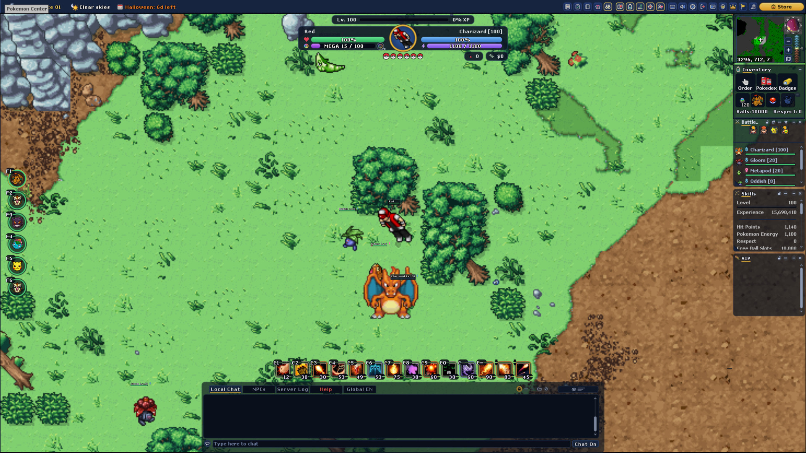 |
| A. Rotom Phone | 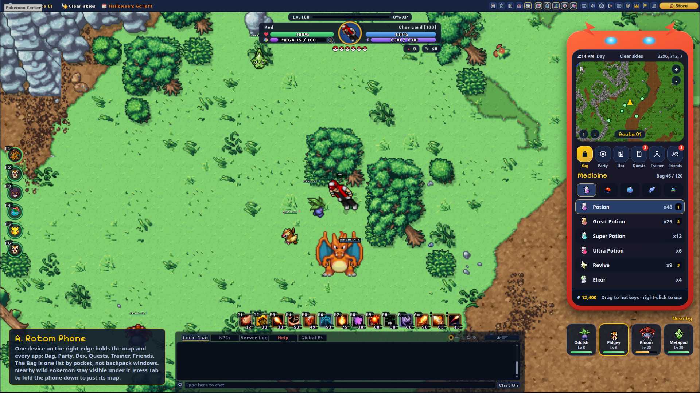 |
| B. Pokegear | 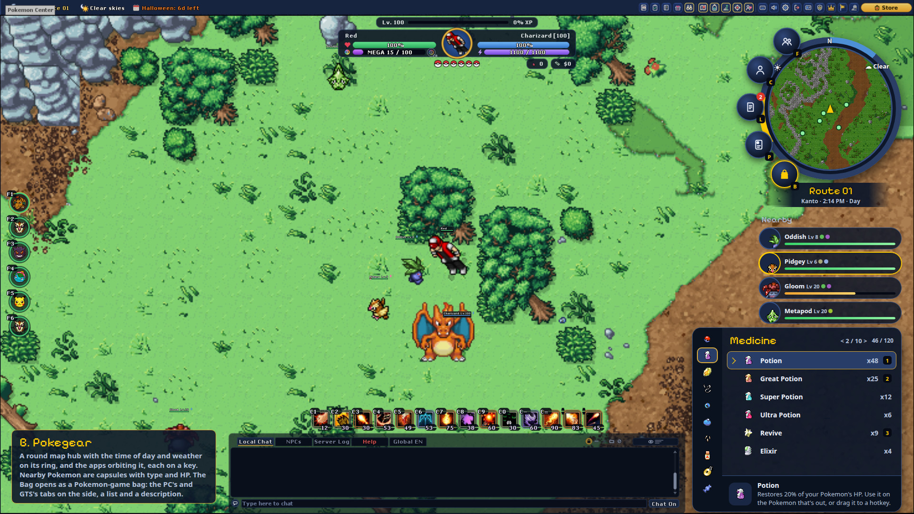 |
| C. Dock and drawers | 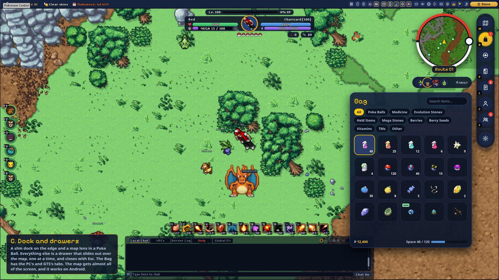 |

The right side of each, at full size: [detail.jpg](detail.jpg). All four together: [board.jpg](board.jpg).

## The three directions

**A. Rotom Phone.** One device, Rotom's red body with its eyes, on the right edge.
- The screen has the time, the weather and the position, a rounded map, and an app row: Bag, Party,
  Dex, Quests, Trainer, Friends.
- The app you pick fills the rest of the screen.
- Nearby wild Pokemon stay outside the phone, as portrait cards with level and HP.
- Tab folds the phone down to just its map.
- The most "Pokemon" of the three, and the easiest to learn, since everything is in one place.
- It also covers the most of the map.

**B. Pokegear.** A round map hub, after HeartGold and SoulSilver.
- The ring around the map carries the time of day and the weather.
- The apps orbit the ring as round buttons, each with its key.
- The place name sits on a ribbon underneath.
- Nearby Pokemon are capsules with their portrait, level, type dots and HP.
- The Bag opens as a real Pokemon-game bag: pockets on the side, a list, and the selected item's
  description at the bottom.

**C. Dock and drawers.** The quietest, and made for Android too.
- A slim dock of round buttons sits on the edge, with a badge for new items or quests.
- The map is a lens inside a Poke Ball.
- Nearby Pokemon fold into a pill of portraits.
- Everything else is a drawer that slides out over the map, one at a time, and closes with Esc.
- The Bag drawer is a grid of big tiles with a search field and pocket filters.

## What replaces what

| Today (Tibia) | A | B | C |
| --- | --- | --- | --- |
| Minimap box | Rounded map on the phone screen | Round map in the ring | Poke Ball lens |
| Backpack boxes, one per bag | Bag app: one list by pocket | Bag: pocket rail, list, description | Bag drawer: tile grid, search, filters |
| Inventory box (Order, Pokedex, Badges, ring, ball) | Apps on the phone | Orbit buttons | Dock buttons |
| Battle List | Nearby cards under the phone | Nearby capsules | Nearby pill, opens to the list |
| Skills text | Trainer app (the Trainer Card) | Trainer orbit button | Trainer drawer |
| VIP box | Friends app | Friends orbit button | Friends drawer |
| Resizing, header buttons, scrollbars | Gone: fixed size, one app at a time | Gone | Gone |

Coordinates move to a tooltip on the map (or the staff view). Level and experience are already on the HUD.

## How it would be built

- **Classic and new.** Today's side windows stay as a **Classic** layout in Options. The new one is
  the default and is built on top of the same modules, so both keep working.
- **Bag.** Items stay in the server's backpacks; the tabs are only a different view of them.
  - The Bag uses the same tabs as the PC stash and the GTS, in the same order. All three read the
    server's `GTS.CATEGORIES`: Poke Balls, Medicine, Evolution Stones, Held Items, Mega Stones,
    Berries, Berry Seeds, Vitamins, Technical Machines and Other, plus All.
  - It uses an item by its id (`g_game.useInventoryItem`, the call the hotkeys use), so no backpack
    has to be shown.
  - What it can't open locally (bags inside bags) comes from the server on an extended opcode, the
    way the PC and the GTS already do.
  - The server sends the category list with the bag, so a new category shows up in all three windows
    at once.
- **Map.** The same minimap widget, with a round or rounded mask and new buttons, then the Pokepedia
  map behind a click. The real map pictures already exist (`scripts/mapper/render_pokepedia.py`).
- **Apps** reuse windows that are already built: the Trainer Card, the Pokedex, the Quest log,
  Pokepedia and the Daycare.
- **Nearby** reads the Battle List's data, so targeting and follow keep working.
- **Order of work.** Drop the old side column and add the Bag view first, because the backpacks are
  the most Tibia part. Then the map frame, then the app buttons, then Nearby.
- **Android.** All three fit on a phone. C needs the least change there.

## Picked so far

- **Two layouts.** Today's layout is kept as **Classic** and keeps working exactly as it does now. The new
  one is **Pokegear** and becomes the default. Settings › Interface gets a Layout dropdown to switch
  between them.
- **Pokegear (B)** for the map and the Bag.
- **The swap bar stays exactly as it is.** The only addition is the Order button next to the Pokemon that's out.
- **Nearby** is its own window, separate from your Pokemon, and keeps the Battle List's filters.
- **Every window can be dragged**, and every box can be split out into its own window and moved anywhere.
- **Default keys:** B Bag, E Order, F equipment, X Pokedex, R Mega Evolution.
- **The Bag, the PC stash and the GTS share the same categories**, each in its own look. The categories
  get filled in properly, so far less ends up in Other.

| | |
| --- | --- |
| Pokegear, all together | 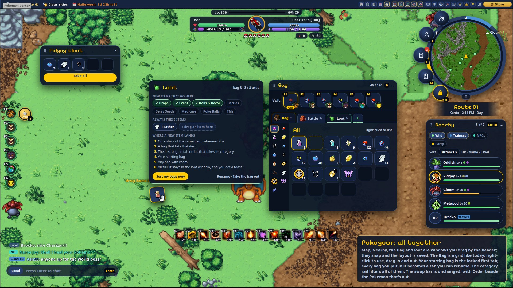 |
| Chat, folded | 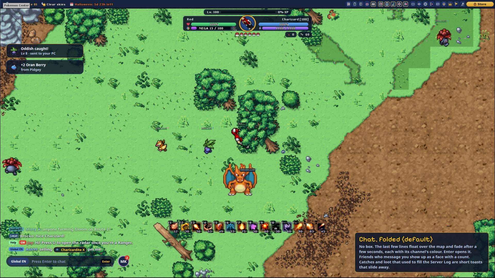 |
| Chat, open | 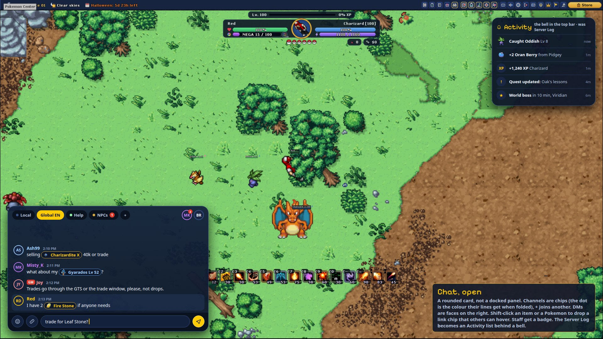 |
| Equipment | 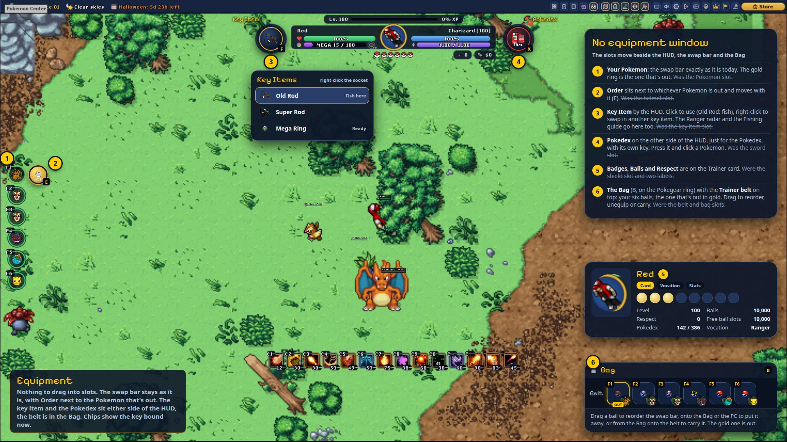 |
| Top bar | 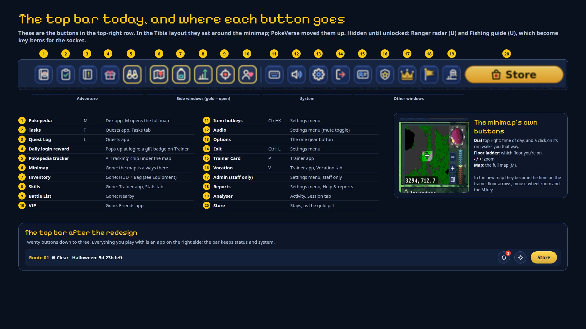 |

**Pokegear, all together.** The ring map with its app buttons, Nearby, the Bag and loot are separate windows.
- Drag a window by its header; the hub has a tab under the ring for this. Windows snap to the
  screen edges and to each other.
- The layout is saved per character. Lock windows and Reset layout go in the gear menu.
- **Nearby** keeps the PokeVerse Battle List's filters and sorts:
  - filters: Wild, Trainers, NPCs, Party (`hideMonsters`, `hidePlayers`, `hideNPCs`, `hideParty`);
  - sorts: distance, HP, name, level;
  - Ctrl+B still toggles it.
- **Minimap ring.** Weather is left to the top bar. On the right of the ring: + and − to zoom, and
  ▲ and ▼ to go up or down a floor, with the floor shown between them. Around the left: Bag (B),
  Pokepedia (M), Quests (L, the badge counts updates), Trainer card (P, with Vocation and Stats tabs)
  and Friends. The tab under the ring drags the whole map.
- **Loot.**
  - Auto loot stays on by default. What it picks up is listed right under the HUD, where the loot
    messages go today in the middle of the screen.
  - If every bag is full or it can't loot something, the item stays on the body and the list says
    "Nothing looted, your bags are full".
  - Opening a body yourself shows a small window with the Pokemon's portrait, the items, Take all and
    an **Auto loot** switch.
  - That switch is the same setting as the Auto loot checkbox in Settings › Controls › General
    (`autoLoot`, which sends `ExtendedIds.AutoLoot` to the server). `/autoloot` sends the new value back,
    so the switch, the checkbox and the command always agree.

**The Bag** works like today's backpack: a grid of squares. Right-click an item to use it, and drag
items in and out (to the ground, a hotkey, the PC, the GTS or another bag).
- **Trainer belt.** A row along the top with your six balls in swap bar order, each showing its
  Pokemon. The one that's out is gold. Drag a ball to reorder the swap bar, onto the Bag or the PC to
  put it away, or from the Bag onto the belt to carry it.
- **Belt switches.** Two small switches under the belt. The server does both, so they work the same
  on any connection; the switch only sends the setting.
  - **Defense mode** (off by default): when something attacks you, or you target something with no
    Pokemon out, your gold ball comes out. If that one has fainted, the next one down the belt does.
    Not in safe zones, and not while surfing, flying or riding.
  - **Auto swap** (on by default): when the Pokemon that's out faints, the next living one down the
    belt comes out after the normal faint delay and becomes the gold one. Only while you're still in
    a fight. With nobody left: one "No Pokemon left to call" message.
  - Both use the normal call cooldown, and stay off in duels and NPC battles, where you choose by hand.
    Both settings are kept with your character.
  - While one is on, the gold ball shows a small mark.
- **Bags as tabs.**
  - Your starting bag is the first tab. It can't be taken off.
  - Any number of bags fit inside it, one slot each. Each holds as many slots as that bag does, so
    bigger bags give more room.
  - Every bag you put inside it gets a tab of its own, with its sprite (a Halloween backpack shows as
    one). The open tab shows its name; the others only their sprite. When they don't all fit,
    ◀ ▶ arrows and the mouse wheel scroll them.
  - Up to 5 bags open as tabs at once, because the server keeps 16 open containers per trainer and
    the belt, corpses and the PC need some. Further bags show in the grid; right-click one to open it
    once a tab is closed.
  - Right-click a tab to rename it, set its sort rules, open it as its own window, or close it. Drag its sprite out to
    take the bag out. Drop an item on a tab to put it in that bag, or on "+" for the starting bag.
  - The name is stored on the bag item, so it keeps the name in the PC or after a trade.
- **The category rail** filters whichever tab is open: All, the GTS and PC categories, plus the new
  ones below.
- **Sort rules per bag.** Each extra bag says which categories it takes, and can pin exact items (for
  example, the Loot bag takes Drops, Event and Dolls & Decor, and always Feathers). A new item, from
  loot, a shop or a trade, lands in the first of these that fits:
  1. a stack of the same item, wherever it is, so potions stay together;
  2. a bag that pins that item;
  3. the first bag, in tab order, that takes its category;
  4. the starting bag;
  5. any bag with room;
  6. if everything is full, it stays on the body (or the NPC doesn't sell it), with a message.

  Rules only decide where a *new* item goes; dragging by hand always wins. "Sort my bags now" (the
  Sort button in the Bag's header) applies the rules to what you already carry: an item a bag's rules
  don't take goes to the bag that does, or back to the starting bag. The server does the routing when
  the item is added, so it also works for NPC shops and the Store.
  - The rules panel ("Sort rules..." on a tab) has a pill per category and up to 12 pinned items:
    drop an item on a slot to pin it, right-click to unpin.
  - The rules are kept on the bag item, like its name, so they go with it to the PC or a trade.
- **Categories for everything.** Today anything not on a list falls under Other. New categories fill
  the gaps:
  - Key Items: rods, the Mega Ring, the Badge Case.
  - Drops: the items Pokemon drop and NPCs buy, like Feather and Bottle of Poison.
  - Event: Halloween tokens and the like.
  - Dolls & Decor.

  Other is kept for what's left. They go into `GTS.CATEGORIES`, so the PC and the GTS pick them up too.

**Chat.**
- **WASD always walks.** Enter opens the chat line, you type, Enter sends it, and you're straight back
  to walking (`returnDisablesChat`, already on). The single-letter keys (B, E, F, X, R) work because of
  this.
  - Pokegear has no Chat On / Chat Off button or setting: it always runs with `wasdMode` on.
  - Today a new install starts with Chat On (`wasdMode` in `game_console` defaults to false). Classic
    keeps that, and keeps its Chat On / Chat Off button.
- **Folded by default, remembered.** A new character starts with the chat open, so it's easy to find.
  Folding or opening it is saved per character and comes back the same at the next login.
- **New messages while folded.** The lines float in as usual. The pill shows an unread count, and
  pulses once for a DM or when someone says your name, instead of blinking all the time.
- **Folded state.**
  - The last few lines float over the bottom left of the map and fade after a few seconds. Each line
    starts with its channel's tag.
  - An input pill shows the channel and "Press Enter to chat".
  - A friend who messages you shows up as a face with a count.
- **Open state.**
  - A rounded card. Channels are chips: Local, Global EN, Help, NPCs, and + to join more.
  - DMs are faces on the right of the header.
  - Shift-click an item or a Pokemon to put a link chip in the message. Staff get a badge.
- **NPCs** get an NPC tag and their own colour, teal (#42e0c4), which no player channel uses. NPC lines
  stay apart from players even in Local. The colours:

  | Channel | Colour |
  | --- | --- |
  | Local | White |
  | Global | Blue |
  | Help | Green |
  | NPC | Teal |
  | DM | Purple |
  | You | Gold |
  | Staff | Red badge |

- **Activity** (built): milestones pop up as toasts above the move bar for five seconds, and an
  Activity list behind a bell in the top bar keeps the last 100, newest first, with a count of the
  unread ones. Only milestones go there, not everything in the Server Log: a GTS sale, a catch, an
  evolution, an egg hatching, a task done, an NPC battle won. Level-ups (yours and your Pokemon's)
  and finished quests already have a banner, so they go in the list without a toast. Everything
  else stays in chat and the Server Log as before, and Classic is unchanged.

**Equipment.** There is no equipment window. Each slot moves to where it is used:

| Slot today | Goes to |
| --- | --- |
| Pokemon (the one that's out) | The swap bar, as it is today: the gold ring marks the one that's out |
| Order (helmet) | A button next to the Pokemon that's out (E). It follows whichever one that is |
| Equipment (bikes, running shoes, the flashlight, the Mega Ring...) | A socket left of the HUD (F): click to use, right-click to equip something else from the Bag, or drop one on it |
| Pokedex (sword) | Its own socket right of the HUD (X) |
| Badges (shield), Balls, Respect | The Trainer card |
| Belt | The Trainer belt at the top of the Bag |
| Bag | The Bag (B, also on the Pokegear ring) |
| Evolve, Duel | Unused, so they go |

**Key chips show the key that is bound now, not the default.**
- Each chip reads `Keybind.getKeybindKeys(category, action)`, which uses the current preset and chat
  mode.
- Pokegear never turns chat mode on, so letter keys stay bound. In Classic with Chat On they are
  unbound, so their chips hide.
- `keybind.lua` has no event when a key changes. `setPrimaryActionKey`, `setSecondaryActionKey`,
  `selectPreset` and `setChatMode` need to send one, so the chips can refresh.

**Top bar.** The buttons in the top-right row, left to right, in the groups that
`sortTopBar` (patches/game_mainpanel.patch) puts them in:

| Group | Buttons (key) | Goes to |
| --- | --- | --- |
| Adventure | Pokepedia (M), Tasks (T), Quest Log (L), Daily login reward, Pokepedia tracker | Dex app, Quests app (with a Tasks tab), a popup at login, a Tracking chip under the map |
| Side windows | Minimap, Inventory, Skills, Battle List, VIP | Gone: these are the windows the redesign replaces |
| System | Item hotkeys (Ctrl+K), Audio, Options, Exit (Ctrl+L) | One gear button with a menu |
| Other windows | Trainer Card (P), Vocation (V), Admin (staff), Reports, Analyser | Trainer app (with a Vocation tab), the gear menu, Activity |
| | Store | Stays |

The Ranger radar (U) and the Fishing guide (U) are hidden until unlocked. The minimap has its own
buttons too: a dial with the time of day (a click on its rim walks that way), a floor ladder, zoom
and the full map. The new map shows the time on its frame, has floor arrows and zooms with the
mouse wheel; M still opens the full map. That leaves the top bar with status on the left and the
bell, the gear and the Store on the right.

**Tracking, Social and the Skills window (mock-ups, waiting for a yes).**

| | |
| --- | --- |
| Tracking card | 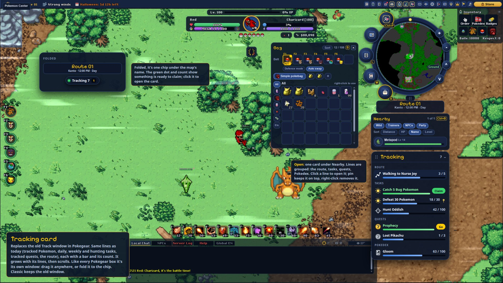 |
| Social window | 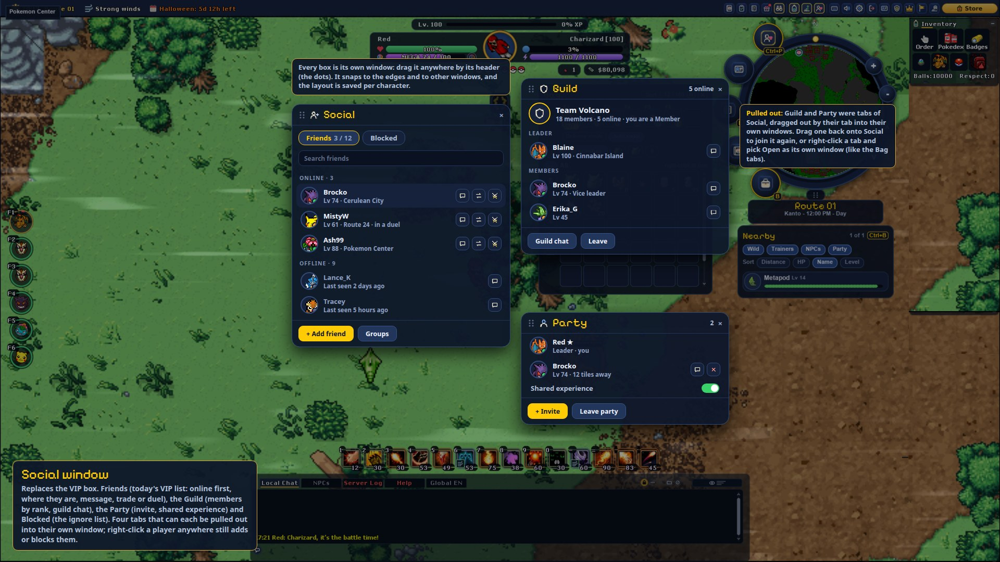 |
| Experience on the HUD | 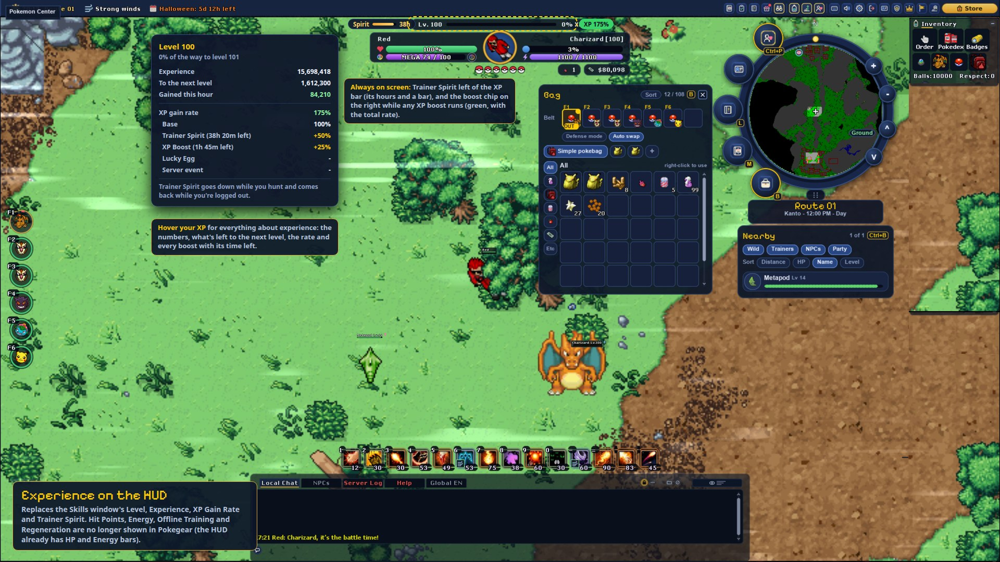 |
| Trainer card with Skills | 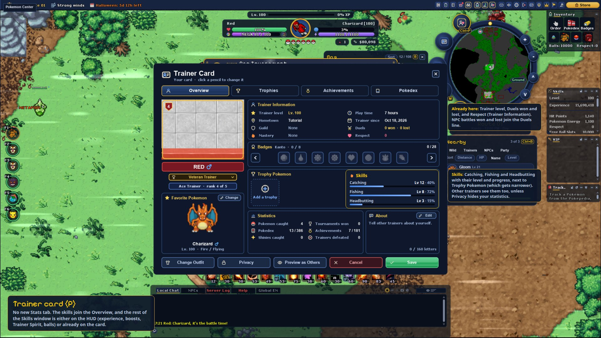 |

- **Every box is its own window.** Drag it anywhere by its header (the dots); it snaps to the screen
  edges and to other windows, and the layout is saved per character. A tab can be dragged out into
  its own window and dropped back onto another to join them, like the Bag tabs.
- **Tracking card** (replaces the Pokepedia tracker window in Pokegear, Stage 4b).
  - The same lines as today: the route while it runs, open daily, weekly and hunting tasks, tracked
    quests and tracked Pokemon, grouped in that order, each with a bar and its count.
  - Claim and Go buttons, pin to the top, remove, and a click opens the Pokedex entry, the task tab
    or the quest.
  - It grows with its lines, then scrolls. Folded, it's a chip under the map's name; a green dot and
    a count show something is ready to claim.
- **Social window** (replaces the VIP box): one window with Friends, Guild, Party and Blocked tabs.
  - Friends: today's VIP list, online first, with where they are and message, trade and duel.
  - Guild: members by rank, guild chat, leave. Party: invite, shared experience, leave. Blocked: the
    ignore list.
  - A tab can still be dragged out as its own window, but doesn't have to be.
  - Right-clicking a player anywhere still adds or blocks them.
- **The Skills window goes away in Pokegear.** Its lines are split up:
  - **Next to the XP bar:** Trainer Spirit (its hours and a bar) on the left, and a boost chip with the
    total rate on the right while any XP boost runs.
  - **Hovering your XP:** level, experience, what's left to the next level, XP gained this hour, the
    XP gain rate and every boost with its time left (Trainer Spirit, XP Boost, voucher, low level
    bonus, Lucky Egg, events, the Ace Trainer perk).
  - **Free Ball Slots** isn't shown: the belt already shows how many slots are left. Hovering the
    Bag's Poke Balls tab lists each catching ball you carry with its count. There's no ball chip on
    the HUD; catching balls go on hotkeys from the Bag, like any item.
  - **The Trainer card's Overview** gets a Skills box next to Trophy Pokemon: Catching, Fishing and
    Headbutting with their level and progress. Trainer level, Duels and Respect are already in its
    Trainer Information; NPC battles won and lost join the Duels line.
  - Not shown in Pokegear: Hit Points and Energy as numbers (the HUD has their bars), Offline
    Training and Regeneration.
- Classic keeps the tracker window, the VIP box and the Skills window.

### Compact Pokegear for small screens (its own project, after the default flips)

At phone size Pokegear doesn't fit: on a screen 1200x509 points across, the ring alone is 400 tall,
Nearby is cut off and the Bag and chat cover the middle of the map. A typical phone is smaller still
(about 914x411).

- **Until it's built, Android stays on Classic.** The Layout option is hidden on Android, and Pokegear
  becoming the default is for Windows and Linux only.
- **When the screen is small, everything scales down to about 60%.** Small means fewer than about 600
  points high, checked again when the window resizes or the phone rotates. The ring, Nearby, Tracking,
  the Bag, the Social window, the chat card, the HUD and its sockets all shrink by the same factor;
  text stays readable (no smaller than the Classic windows' font).
- **Nearby, Tracking and chat start folded.** Nearby and Tracking show as chips under the map's
  name, and the chat card as its one-line input with the channel chips. Tapping a chip opens it; it
  folds again on its own after a while without a touch. What the player unfolds is kept per
  character, like on desktop.
- **The Bag and the Social window open over the map** (centred, with a close button big enough for a
  thumb) instead of beside the ring, and only one of them at a time.
- **Touch:** dragging a window by its header works as on desktop; a long press stands for right
  click (use an item, the Nearby menu), as the Android touch controls already do.
- **Tested** with the harness at phone and tablet sizes (914x411, 1200x509, 1280x800), on both
  layouts, plus a switch back and forth like the desktop audit.

## To decide

- Tracking, Social and the Skills window split: the mock-ups above.
