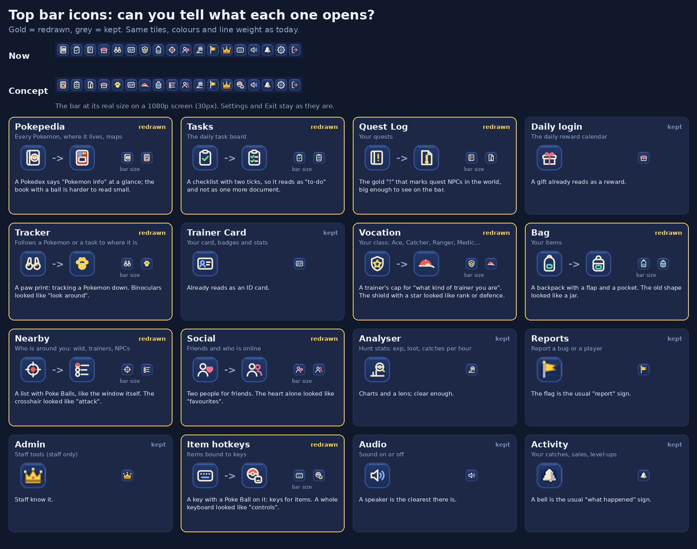
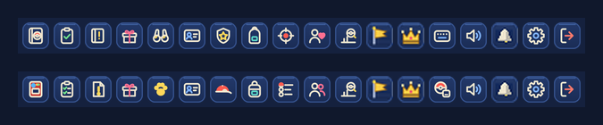

# Top bar icons: clearer at a glance

The goal: each top bar button should say what it opens before you hover it. Pokemon objects are used
where they say it best (Pokedex, Poke Ball, paw print, trainer's cap); plain symbols stay where they
are already clear.

Tiles, colours and line weight are the same as today (`scripts/art/topbar_icons.py`). Only the art
inside nine tiles changes.

| Button | Now | Concept | Why |
|---|---|---|---|
| Pokepedia | book with a ball | Pokedex | "Pokemon info" at a glance |
| Tasks | clipboard, one tick | checklist, two ticks | reads as a to-do list, not a document |
| Quest Log | book with a small "!" | page with a big gold "!" | the quest NPC mark from the world |
| Tracker | binoculars | paw print | tracking a Pokemon down, not "look around" |
| Vocation | shield with a star | trainer's cap | what kind of trainer you are |
| Bag | jar-like bag | backpack | looked like a jar |
| Nearby | crosshair | list with Poke Balls | the crosshair looked like "attack" |
| Social | person and heart | two people | the heart looked like "favourites" |
| Item hotkeys | keyboard | Poke Ball and a key | keys for items, not "controls" |

Kept: Daily login (gift), Trainer Card, Analyser, Reports (flag), Admin (crown), Audio (speaker),
Activity (bell), Settings, Exit and the Store.

Real size, now over concept:

Redraw the sheet with `python3 docs/concepts/topbar-icons/icons.py`.

If it goes ahead: the chosen icons move into `scripts/art/topbar_icons.py` (Reports, Admin and
Activity have no vector source yet), and the phone drawer gets its own 44px drawing instead of the
20px art scaled up.
