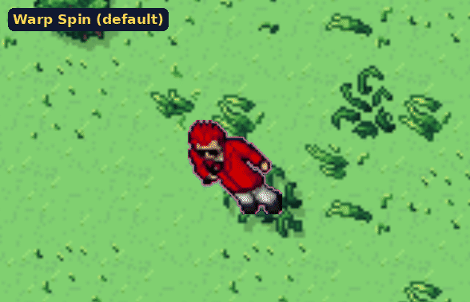
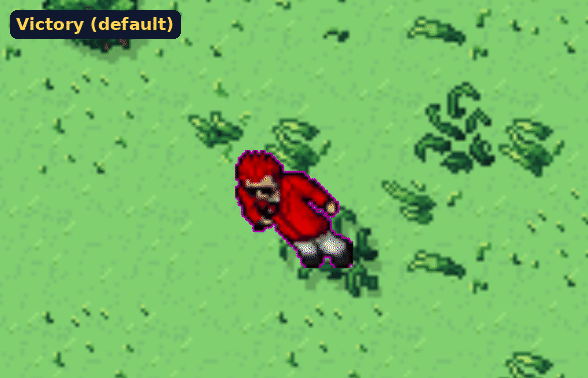

# Warp Styles: animated concepts

Warp Styles are cosmetic animations for a trainer's big moments: logging in, logging out,
teleporting, and winning or losing a duel against a player or an NPC. You equip one for each
trigger in the Customise Character window, and everyone nearby sees it. The plan is
[section 28 of upcoming features](../../upcoming-features.md#28-warp-styles-first-styles-built).

These are concept animations, not game art. They were drawn over a real Route 1 screenshot from the
client, using the game's own trainer and Pokemon sprites, to show the timing and the idea of each
style. The concepts are approved. The finished art will be pixel sprite sheets drawn at the
game's scale, using the real Pokemon sprites and shaded with more depth than these flat drafts.

## Warps: log in, log out and teleport

Each one plays a full log out and log back in.

| Style | Out | In | Who has it |
|---|---|---|---|
| **Warp Spin** (the default)  | A Poke Ball pad lights up under the trainer, who spins faster and faster and zips up into the sky, like the warp panels in Silph Co. and Saffron Gym | A streak of light comes down, the trainer lands spinning and slows to a stop | Everyone |
| **Beam**  | A column of light comes down and scans the trainer away from the feet up | The beam builds the trainer back from the feet | Premium |
| **Poke Ball**  | A Poke Ball is thrown, opens, and red light pulls the trainer in. It wobbles three times and clicks | The ball drops and bounces, then opens with a white flash and the trainer comes out | Quest, Store or event |
| **Psychic (Abra)**  | Abra blinks in beside you and its eyes glow. The trainer ripples purple, folds into a line and is gone | The line opens back out into the trainer in purple ripples | Quest, Store or event |
| **Dig (Diglett)**  | A Diglett pops up and digs. The trainer drops into the hole in a spray of dirt, then the hole closes | A hole opens and the trainer climbs out | Quest, Store or event |
| **Fly (Pidgeot)**  | Pidgeot swoops in, the trainer climbs on and they fly off the top of the screen | Pidgeot lands with a gust, drops the trainer off and flies away | Quest, Store or event |
| **Smoke Bomb (Koffing)**  | A smoke ball hits the ground, Koffing peeks out of the cloud, and when it clears nobody is there | A puff of smoke clears and the trainer is standing in it | Quest, Store or event |
| **Shadow (Gengar)**  | The trainer's shadow spreads into a pool, Gengar grins out of it and the trainer sinks into the dark | The pool opens and the trainer rises out of it | Quest, Store or event |

Each warp is one animation played forwards for leaving and backwards (or mirrored) for arriving,
so a style is one art set, not three.

## Duels: victory and defeat

These play on the trainer when a duel with a player or an NPC ends. Nobody leaves.

| Effect | What happens |
|---|---|
| **Victory** (the default)  | Two little hops, a gold burst and Poke Ball confetti, then a badge glint over the head |
| **Defeat** (the default)  | The trainer slumps and goes grey, dizzy stars circle the head and a little rain cloud drizzles over them |

## How the concepts were made

The client captured the map with the trainer and without him, and the sprites on a plain
background: the trainer facing all four ways, plus Pidgeot, Abra, Gengar, Diglett and Koffing. A
Python script then drew each effect frame by frame on top. Effect particles are drawn in fat
pixels about one game pixel across so they sit with the sprites.
