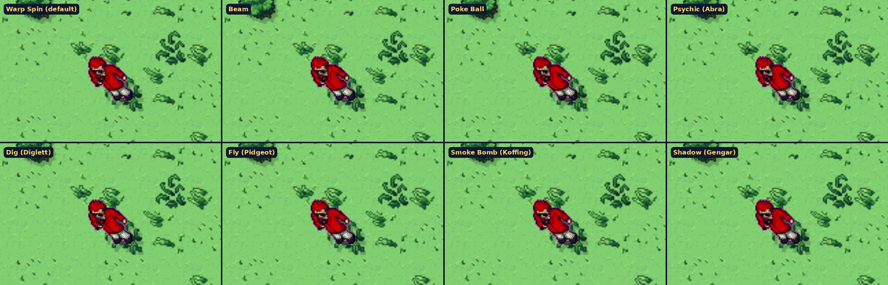
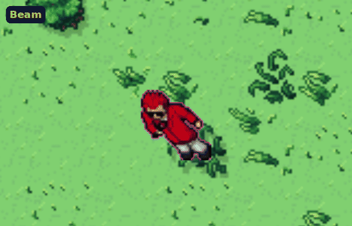
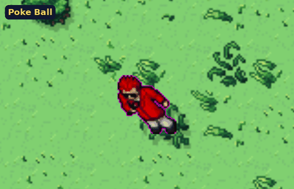
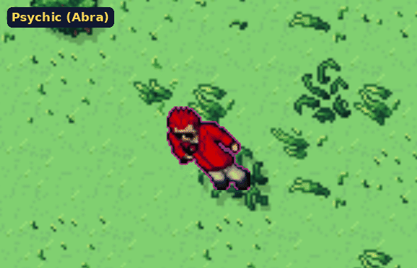
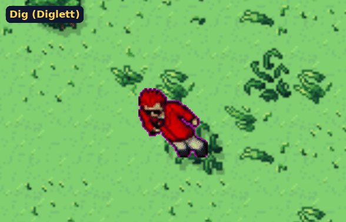
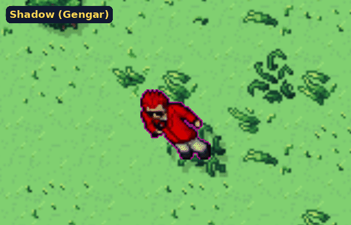

# Warp Styles: animated concepts

Warp Styles are cosmetic animations that play when you log in, log out, faint or teleport.
You pick one style for each of these, and everyone nearby sees it. The plan is
[section 28 of upcoming features](../../upcoming-features.md#28-warp-styles-planned-not-built).

These are concept animations, not game art. They were drawn over a real Route 1 screenshot from the
client, using the game's own trainer and Pokemon sprites, to show the timing and the idea of each
style. Each one plays a full log out and log back in. The finished art will be pixel sprite sheets
drawn at the game's scale.

## All eight together

## Each style

| Style | Out | In |
|---|---|---|
| **Classic** (free, the default)  | Today's blue teleport sparkle: the trainer fades out inside it | The sparkle again, the trainer fades in |
| **Beam**  | A column of light comes down and scans the trainer away from the feet up | The beam builds the trainer back from the feet |
| **Poke Ball**  | A Poke Ball is thrown, opens, and red light pulls the trainer in. It wobbles three times and clicks | The ball drops and bounces, then opens with a white flash and the trainer comes out |
| **Psychic (Abra)**  | Abra blinks in beside you and its eyes glow. The trainer ripples purple, folds into a line and is gone | The line opens back out into the trainer in purple ripples |
| **Dig (Diglett)**  | A Diglett pops up and digs. The trainer drops into the hole in a spray of dirt, then the hole closes | A hole opens and the trainer climbs out |
| **Fly (Pidgeot)**  | Pidgeot swoops in, the trainer climbs on and they fly off the top of the screen | Pidgeot lands with a gust, drops the trainer off and flies away |
| **Smoke Bomb (Koffing)**  | A smoke ball hits the ground, Koffing peeks out of the cloud, and when it clears nobody is there | A puff of smoke clears and the trainer is standing in it |
| **Shadow (Gengar)**  | The trainer's shadow spreads into a pool, Gengar grins out of it and the trainer sinks into the dark | The pool opens and the trainer rises out of it |

Each style is one animation played forwards for leaving and backwards (or mirrored) for arriving,
so a style is one art set, not four.

## How the concepts were made

The client captured the map with the trainer and without him, and the sprites on a plain
background (the trainer and Pidgeot, Abra, Gengar, Diglett and Koffing). A Python script then drew
each effect frame by frame on top. Effect particles are drawn in fat pixels about one game pixel
across so they sit with the sprites.
